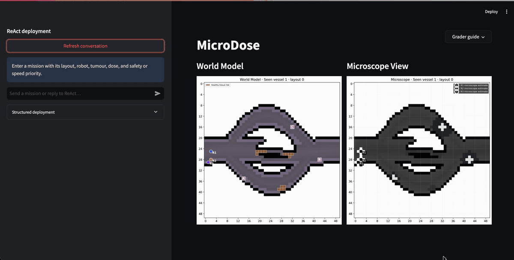

# Microdose



Microdose is a simulated drug-delivery agent that interprets natural-language dosage instructions using a ReAct framework, selects heuristic search or reinforcement learning for control, and checks mission and dosage constraints with Z3 formal verification.

This was built as the end-term project for the course ***COMP343: Autonomous Agents and Sequential Learning***. Some of the components are a response to certain requirements.

Use Python 3.11. Clone the repository and enter its directory:

```bash
git clone https://github.com/tejas-n-rao/Microdose.git
cd Microdose
python3.11 -m venv .venv
source .venv/bin/activate
python -m pip install -r requirements.txt
python -m streamlit run streamlit_app.py
```

Natural-language deployment also requires `OPENAI_API_KEY` in `.env`. However, the `structured controls` and experiments do not.

The grader guide is built into the UI, including prompts, robot/reagent reference and clickable seen/unseen segmented world views. Runtime rules and experiment results are recorded in [the technical report](technical_report.md).

## Project

The goal is to build an autonomous-agent system for a simulated microrobot drug-delivery task. The idea was based on the following paper: 

> Medany, M., Piglia, L., Achenbach, L., Mukkavilli, S. K., & Ahmed, D. (2025). Model-based reinforcement learning for ultrasound-driven autonomous microrobots. Nature machine intelligence, 7(7), 1076–1090. https://doi.org/10.1038/s42256-025-01054-2

The agent represents a microscopic drug carrier moving through a vessel-like environment to reach a tumour and release a controlled drug dose while avoiding healthy tissue, chaotic flow regions, deadspace, and unsafe release decisions.

The system must translate natural-language instruction into a structured mission, estimate where the microrobot and tumour are from noisy microscope input, plan a route through a vessel map, and execute under stochastic drift. ReAct orchestrates tools and uses a formal solver to check the feasibility of proposed plans of actions. Z3 checks the mission before movement and checks dosage again before release. If the request is infeasible, the system stops, explains the conflict, and asks for a correction or a verified alternative.

The interface is a Streamlit dashboard displaying the vessel map, microscope view, actual trace, microscope estimate, reward metrics and ReAct traces. The current code simulates microscope perception rather than training a real segmentation network. Multiple robots can move on one shared timestep, and one robot can perform ordered deliveries.

## Using the dashboard

Install and run with the commands above. Natural-language deployment is the default: enter a layout, robot, tumour, dose and safety/speed priority in the left-hand chat. For example:

```text
For Layout 1, Deploy R1 to B safely, and R3 to B fast. Deliver 20 units each.
```

Review the chatbox, answer any clarification, and choose a proposed plan when needed. Structured controls let you select the layout, environment and robots without an OpenAI call. The right-hand grader guide has copyable prompts and the robot reference. Refresh conversation clears the current request while retaining database history.

Experiment commands, offline policy preparation, outputs and reproducibility instructions are in the [technical report](technical_report.md#experiments-and-final-system-choices). The report also explains how the experiments shaped the final controller choices.


<details>
<summary>Files and what each one does</summary>

| File | Function | What it does |
|---|---|---|
| [streamlit_app.py](streamlit_app.py) | UI | Runs the dashboard, with a chat for missions and controls for setting them by hand. |
| [config/microdose_inputs.json](config/microdose_inputs.json) | Configuration | Sets the vessel shapes, movement noise, microscope errors and reward settings. |
| [config/mission_rules.json](config/mission_rules.json) | Configuration | Lists which reagents match each tumour, dose limits, robot capacity and sensor rules. |
| [src/__init__.py](src/__init__.py) | Package | Makes the source folder a Python package. |
| [src/robot_identity.py](src/robot_identity.py) | Helper | Converts the internal robot IDs into R1, R2 and R3 for display. |
| [src/storage.py](src/storage.py) | Storage | Keeps robot inventory, mission history, current status and saved policies in SQLite. |
| [src/policy_store.py](src/policy_store.py) | Policy loading | Loads a saved policy from SQLite and checks that it fits the requested mission. |
| [src/algorithms/__init__.py](src/algorithms/__init__.py) | Package | Makes the planners and grid types available to the rest of the project. |
| [src/algorithms/a_star.py](src/algorithms/a_star.py) | Controller algorithm | Finds a shortest route using A*, with three distance heuristics to compare. |
| [src/algorithms/dijkstra.py](src/algorithms/dijkstra.py) | Controller algorithm | Finds a shortest route without a heuristic, as a baseline for the A* experiment. |
| [src/algorithms/grid.py](src/algorithms/grid.py) | Algorithm helper | Checks which cells are open, finds neighbouring cells and calculates distances. |
| [src/algorithms/q_learning.py](src/algorithms/q_learning.py) | Controller algorithm | Trains Q-learning policies and uses the saved action values to choose moves. |
| [src/algorithms/sarsa.py](src/algorithms/sarsa.py) | Controller algorithm | Trains SARSA policies, using the next action actually sampled in each update. |
| [src/algorithms/rl_utils.py](src/algorithms/rl_utils.py) | Algorithm helper | Shares the exploration schedule, state indexing and training setup between the learners. |
| [src/algorithms/deployment.py](src/algorithms/deployment.py) | Policy loading | Keeps the saved-model naming scheme and the folder used for old policy exports. |
| [src/agents/microdose_react.py](src/agents/microdose_react.py) | Agent | Runs the ReAct loop, turns instructions into missions and responds to tool feedback. |
| [src/agents/mission_models.py](src/agents/mission_models.py) | Agent helper | Defines the fields used in tool calls, mission plans and clarification requests. |
| [src/agents/mission_tools.py](src/agents/mission_tools.py) | Agent tools | Extracts stated mission details, calls SMT and offers corrections when a request fails. |
| [src/verification/smt_verifier.py](src/verification/smt_verifier.py) | Verifier | Checks whether the requested robots, reagents, doses and controllers are allowed together. |
| [src/verification/dosage_verifier.py](src/verification/dosage_verifier.py) | Verifier | Checks released reagent against the robot allocation and the tumour dose limit. |
| [src/verification/timestep_verifier.py](src/verification/timestep_verifier.py) | Verifier | Checks proposed moves together so robots do not occupy or cross conflicting paths. |
| [src/verification/rejection_explanations.py](src/verification/rejection_explanations.py) | Verifier helper | Explains why SMT rejected a request and what the user can change. |
| [src/simulation/microdose_env.py](src/simulation/microdose_env.py) | Environment | Builds the vessel layouts and simulates drift, tissue risk and noisy microscope positions. |
| [src/simulation/rl_environment.py](src/simulation/rl_environment.py) | Environment | Provides the movement and release simulation used to train and compare controllers. |
| [src/simulation/live_controller.py](src/simulation/live_controller.py) | Controller execution | Moves one robot, handles A* recovery and checks whether it can release its dose. |
| [src/simulation/fleet_controller.py](src/simulation/fleet_controller.py) | Controller execution | Moves robots on a shared clock and starts their next tasks when a delivery finishes. |
| [src/simulation/environment_sensor.py](src/simulation/environment_sensor.py) | Sensor simulation | Produces a flow prediction using the chosen sensor error rates. |
| [src/simulation/rewards.py](src/simulation/rewards.py) | Reward | Adds up movement costs, delivery benefit and failure penalties. |
| [src/simulation/safety_metrics.py](src/simulation/safety_metrics.py) | Metric | Calculates the separate safety score from observed tissue exposure and wall contacts. |
| [src/ui/live_views.py](src/ui/live_views.py) | UI | Draws the purple world model, microscope view and robot starting positions. |
| [src/ui/fleet_view.py](src/ui/fleet_view.py) | UI | Shows both live views and a table of each robot's task, controller and status. |
| [src/ui/grader_guide.py](src/ui/grader_guide.py) | UI | Brings the prompts, robot details and vessel previews into the collapsible guide. |
| [src/ui/prompt_examples.py](src/ui/prompt_examples.py) | UI | Lists prompts to try, including requests that should be rejected. |
| [src/ui/robot_reference.py](src/ui/robot_reference.py) | UI | Shows what each robot carries, which tumours it can treat and its capacity. |
| [src/ui/snapshot_browser.py](src/ui/snapshot_browser.py) | UI | Lets the grader click through seen and unseen vessel layouts. |
| [scripts/prepare_deployment_policies.py](scripts/prepare_deployment_policies.py) | Training | Trains and saves Q-learning and SARSA policies before deployment. |
| [scripts/run_experiments.py](scripts/run_experiments.py) | Experiment | Compares delivery, travel and safety using the same trial seeds for each controller. |
| [scripts/run_astar_heuristic_sweep.py](scripts/run_astar_heuristic_sweep.py) | Experiment | Compares A* heuristics with Dijkstra and checks every route against BFS. |
| [technical_report.md](technical_report.md) | Documentation | Explains the simulation, design choices, experiment results and limitations. |
| [microdose-demo.gif](microdose-demo.gif) | Demo | Shows a recorded deployment at twice its original speed. |
| [requirements.txt](requirements.txt) | Setup | Lists the Python packages needed to run the dashboard and experiments. |

Local `.env` holds API settings and is ignored by Git. Generated `outputs/microdose.sqlite3` stores inventory, history and NPZ policy BLOBs; `outputs/deployed_policies/` retains legacy migration backups. Experiment CSVs and plots are generated under `outputs/experiments/`.

</details>
