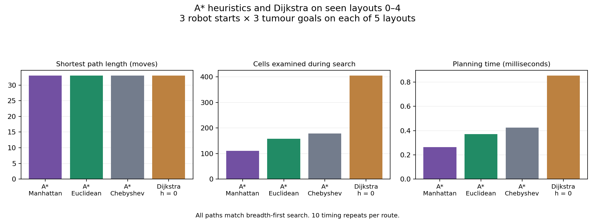
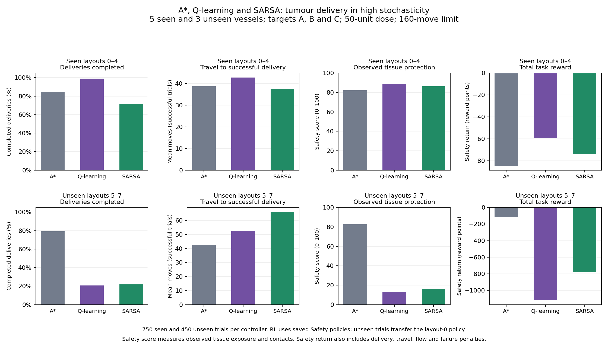
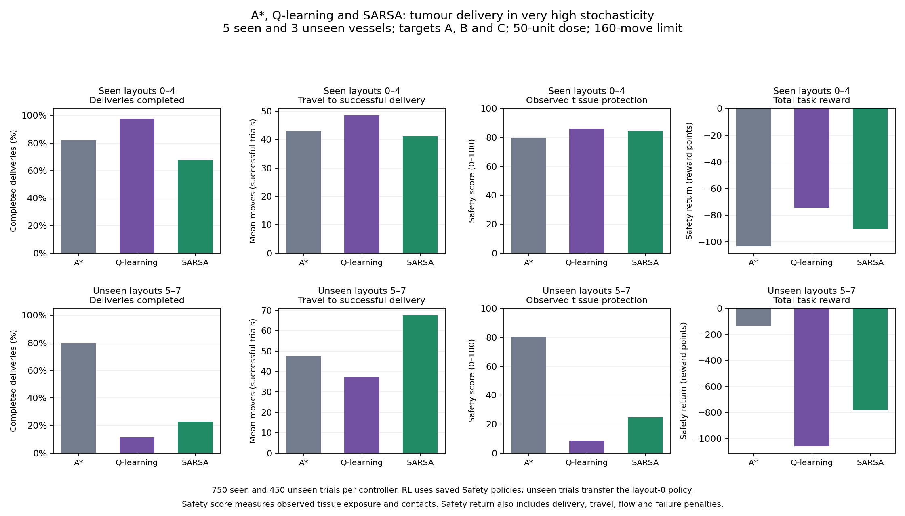
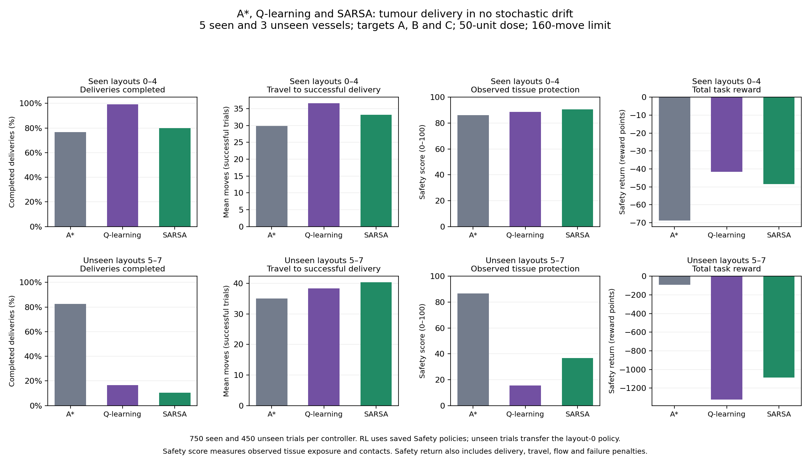
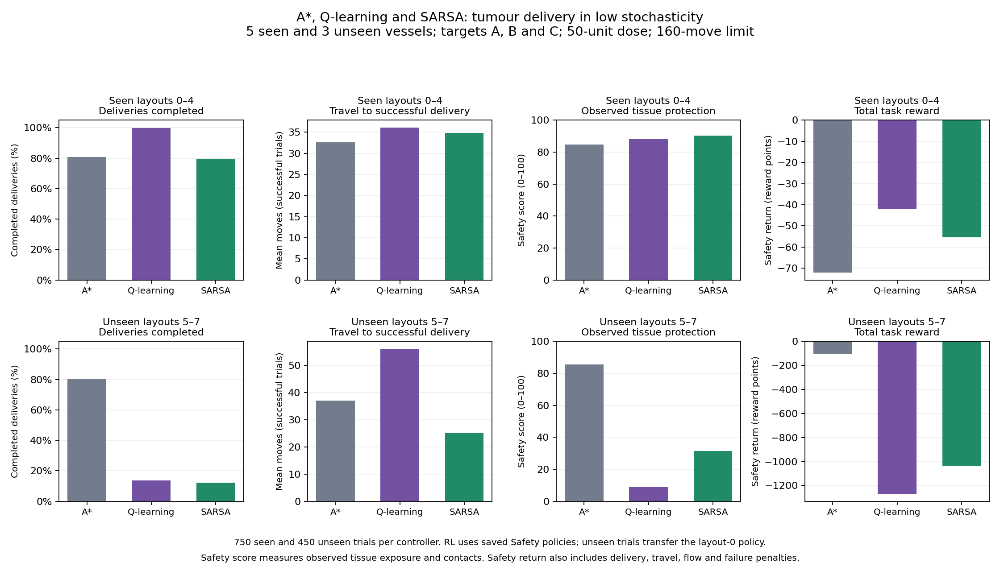

# MicroDose Technical Report

This report describes the application, the environment developed, the reward structure, the RL controller comparisons, and a static A* heuristic sweep.

## System and repository

MicroDose simulates tumour-directed drug delivery in 50×50 vessel grids. ReAct extracts a mission from natural language, Z3 verifies its constraints, and saved controllers execute it. Natural-language interaction remains on the left. I simulate a microscope view (what the microscope sees plausibly), and world-model views (obtained after real time segmentation into the tumours, robots etc), which update side by side. The structured controls section supports manually choosing the layout, environment stochasticity, robots being deployed and their target, dose and controller selection. A  collapsible grader guide was generated using a coding agent, and contains prompts to test various cases, as well as a robot/reagent reference, and the different layouts.

## Environment

This was generated using an LLM also, after various iterations. Each layout defines upper, middle and lower traversable routes. There are inaccessible vessel cells, boundary walls and dead spaces to constrain motion. Layouts 0–4 were available to derive the policy, and I examine how the policies generalize. Their distinct launch and tumour positions are derived from each layout seed. 

Robots R1/R2/R3 have defined, distinct launch positions. A carrier chooses a to move Up/Down/Left/Right from its estimated position. The simulator applies that command at its actual position. The environemt is also stochastic, with horizontal and vertical drifts sampled independently. 

| Mode | Horizontal slip | Left bias | Vertical slip | Down bias | Flow decay | Flow-source scale |
|---|---:|---:|---:|---:|---:|---:|
| deterministic | 0% | 90% | 0% | 75% | 1 | 0 |
| low | 8% | 85% | 3% | 75% | 0.998 | 0.35 |
| stochastic | 25% | 82% | 10% | 72% | 0.995 | 1 |
| very_high | 38% | 80% | 18% | 70% | 0.992 | 1.45 |

In the Natural-language mode, the environment has 30% chance of being in a low stochastic mode, 60% in high stochastic mode and 10% very high stochasticity. You can choose deterministic environments in structured controls. All concurrently deployed robots share one environment. 

As the project mandates fuzzy perception, this is how it was implemented here: Each microscope coordinate has an 8% chance of drawing an offset from {−1,0,1}.

There is also assumed to be "tumour-reach" sensor, which I assume can be queried when either actual or estimated position is within the target region. It reports actual reach with 90% accuracy and the opposite status otherwise. A false-positive release can therefore occur outside the true tumour. Each move ending at a cell with healthy-tissue risk greater than a set threshold (0.18, see the rewards section) has a 20% accidental-release probability. Delivery success is audited against actual target location. It is assumed that travel consumes no reagent (one that hold well for real microrobots), and terminal delivery or off-target release consumes the allocation. Timeout consumes none.

## Robots and SMT admission

| UI robot | Reagents | Compatible tumours | Capacity |
|---|---|---|---|
| R1 | X | A, B | 60 units |
| R2 | Y | C | 60 units |
| R3 | X + Y | A, B, C | 60 units |

A/B are tumor type 1 and C is type 2. Type 1 requires reagent X and type 2 reagent Y. Labels R1/R2/R3 denote robots. I assume the mixed payload configuration makes no clinical efficacy, antagonism or mixed-dose claim.

k

Z3 solver uses mission payloads, as well as indexed carrier/controller variables and named tracked assertions to get SAT/UNSAT. Rejection of a request occurs when UNSAT occurs, i.e., when concrete violations of constraintd occurs. ReAct receives solver observations and can propose alternate carrier allocations or reduced doses. Choosing a proposal stages a new request and verification, rather than silently deploying a changed plan. 

This is a list of checks Z3 performs:

- Positive, finite dose and valid layout, tumour, carrier and admitted controller.
- Reagent/type compatibility: A mismatch requires a compatible revised plan or explicit plan-bound mismatch permission.
- Shared per-tumour dose caps: A=50, B=55, C=50 units, aggregated across robots/tasks. Excess dose must be corrected and cannot be overridden.
- Aggregate 60-unit capacity per robot. Capacity cannot be overridden by an instruction or another permission.
- One simultaneous assignment per robot. “Then” / “after that” allow repeated robots in an ordered sequence. Here, allocations must still share capacity and tumour budgets.
- Target and safety mode (urgent/safe): Target A/B/C must be mentioned in the prompt, a urgency does not waive dose, compatibility or movement rules. If safe mode selected, RL controller, if not use A* controller.
- Sensor acceptance rules: I assume that in the very high stochasticity mode, the robot shouldn't be going fast, to minimize wear and tear in the robots. Thus, I assume that I have access to some sensor data that can be used by a binary classifier if it is in a high stochasticity mode. These are the synthetic numbers to describe the classifiers working in the simulation:

| Ground truth state| Probability that it is predicted to be very high |
|---|---|
| Very high | 85% |
| High | 10% |
| Low | 2% | 
| Deterministic | 0% | 

If the classifier predicts that the robot is in a high stochasticity mode, RL for safety must be used, and ReACT prompts users to either abort the mission, or to use safety mode. 


## ReAct and controller selection

ReAct mirrors the lab code, and emulates the JSON and Pydantic argument validation, dispatch and observation loop. It has at most eight iterations. 

Without a sensor alert, tissue protection taking precedence over travel time selects Q-learning Safety on seen layouts. Speed selects distance A*. Unseen layouts use A*. ReAct admits no other learned controller. Structured controls expose Q-learning Safety and SARSA Safety on seen layouts.

A* uses unit edge costs and Manhattan distance, following the heuristic sweep experiment below. In the live UI, a perceived departure triggers a short recovery path to the next fixed reference waypoint, then the robot resumes that reference route. 

In case of 2 robots requiring to proceed to the same cell, robots that are supposed to be 'fast' are given priority. If both robots have equal route types, I use a contender randomly. 


## RL rewards and evaluation metrics

Q-learning and SARSA use the same Safety reward: a score accumulated over a delivery. The state is the microscope-estimated position. The actions are four cardinal moves. Training uses a learning rate of 0.15, a discount factor of 0.99, and exploration decreasing from 0.80 to 0.05.

*Hazard* is a synthetic score for each cell, and is between 0 and 1. It combines proximity to healthy-cell clusters, a configured shear band (a strip representing mechanical stress), and a vessel-centre disturbance penalty, minus geometry-based safety allowances. *Flow* is a separate 0–1 field representing local flow intensity. it evolves with decay and sources. Neither score is a measured injury probability. *Wall contact* means the destination chosen to be moved to is blocked due an obstacle. *Healthy-tissue risk* is a subpart of the hazard risk. It quantifies proximity to healthy cells and also determines where accidental release can occur. Some aspects of these metrics were generated by an LLM, as I was unsure of mathematically precise way to combine multiple independent scores into a 0-1 metric. However, I knew i wanted to assign a safety score, and devised a way to do so independently (below), but needed a way to quantify the qualitative direction I needed. The weight of hyperparameters for the the resulting reward function was almost arbitrary, based on how much I wanted to avoid hazard, and flow. 

```text
movement reward = −0.75 − 15 × hazard − 2 × flow − contact penalty
contact penalty = 10 for a blocked move, otherwise 0
```

I chose these terms to balance protection with completing treatment:

- **Hazard:** proximity to healthy cells and the simulated stress regions should make a route less attractive. Its larger weight lets the robot accept a detour to avoid them.
- **Flow:** stronger local fluid motion represents more difficulty maintaining control. I raise disturbance and flow near vessel centres in this simulator, encouraging calmer routes. This is a modelling assumption i thouhgt would be interesting to bake in, and not a fact that centres are always turbulent.
- **Wall contact:** penalizing blocked moves discourages repeated collisions and getting stuck against a boundary.
- **Movement and delay:** a small movement cost discourages wandering without making the shortest route mandatory. Reduced treatment benefit with delay gives the robot a reason to finish.
- **Delivery and failure:** treatment benefit rewards releasing at the tumour. The toxicity term discounts the benefit of larger prescribed doses. RL does not choose the dose. SMT checks the requested allocation. Off-target release penalizes releasing in the wrong place. I increased the timeout cost after a policy learned to circle near its launch point without delivering, so avoiding exposure alone cannot substitute for completing the task.


Successful delivery earns dose-dependent benefit minus synthetic toxicity, plus 10 points for an in-tumour release. Off-target release loses 50 points. Timeout loses 120. A* receives the same evaluation score, although it plans using distance alone, making Safety returns comparable across controllers. 

The separate **observable safety score** uses healthy-tissue risk at microscope-estimated cells and logged wall contacts:

```text
safety = 100 × exp(− accumulated observed tissue risk / 5 − wall contacts / 5)
```
This score uses observed tissue exposure and wall contacts directly, which is why I used an LLM for a precise formulation. Higher scores mean less observed exposure/contact. The scaling by 5 is arbitrary, but was informed loosely by the numerical value of plots (Geogebra used). 

It is worht noting that a robot can time out with little exposure and still score highly, so this score must be read beside delivery rate (which is relevant to my Q-learning vs SARSA decision). Neither measure establishes clinical safety.

**Safety return** is the sum of all episode rewards: treatment benefit minus movement, hazard, flow, contact and failure penalties. It measures the combined delivery/protection objective, can be negative, and has no fixed range. Higher (including less negative) is better. It excludes the extra distance-based guidance used during training.


**Delivery rate** is the percentage of trials that release at the actual tumour. **Speed** is mean moves on successful deliveries. It compares different subsets when delivery rates differ.

#### Time out rewards

In a previous reward structure time-out errror was -20, which I assumed was high enough. However, for the request “For Layout 4, Deploy R1 to B safely, and R3 to B fast. Deliver 20 units each” there was a large error in the learned-policy. R1 repeatedly moved between two cells near its launch point until timeout, because of a greedy Q-value loop. Testing showed that the previous timeout penalty of −20 did not prevent this behavior. I increased the timeout penalty to −120, and kept the other reward weights unchanged, and retrained all saved policies. This lead to the command working again, where R1's dose was delivered.


## Experiments and final system choices

The experiment outputs informed the final controller choices below. Evaluation now covers **all five seen layouts (0–4)** and three unseen layouts (5–7), targets A/B/C and all four environment modes. Each controller uses 50 matched episode seeds per target/layout/mode, a 50-unit dose and a 160-move limit. Seen policies load the matching saved model. Unseen trials transfer the frozen layout-0 policy without retraining. I retrained all 120 Safety models for 12,000 episodes using the reward weights above and the 20% healthy-tissue accidental-release probability, then regenerated the results and figures shown here.

Run these commands from `Final_Project/`, after installing dependencies. Experiments load saved policies and require no OpenAI key.

### Choosing the A* heuristic

```bash
python scripts/run_astar_heuristic_sweep.py --repeats 10
```

The sweep compares A* with Manhattan, Euclidean and Chebyshev, plus Dijkstra as a baseline without heuristic guidance. It covers all seen layouts, using every robot start and tumour goal. Seen/unseen status does not change these distance heuristics: each uses the same known map, so this sweep focuses on seen layouts. Each returned path is checked against breadth-first search. All four find shortest paths, but Manhattan examines fewer cells on average. This supports Manhattan as the default for the four-direction grid. Repeated timings measure planning effort, not delivery under drift.



[Heuristic results](outputs/experiments/astar_heuristics/summary.csv) and [per-route records](outputs/experiments/astar_heuristics/routes.csv) are saved under `outputs/experiments/astar_heuristics/`.

### Comparing A*, Q-learning Safety and SARSA Safety

```bash
python scripts/run_experiments.py --comparison rl_safety --runs 50
```

This comparison answers two questions: when to use RL instead of A*, and which learned controller to deploy. Each plot separates seen and unseen vessels and shows delivery rate, successful-delivery travel, safety score and Safety return. The standalone A*/Q-learning plots are a subset, so they are not repeated here.

After retraining, Q-learning has a higher delivery rate and better Safety return than SARSA across the seen environment modes. SARSA has the higher safety score without drift and in low stochasticity, while Q-learning scores better in high and very-high stochasticity. I prioritize completing the prescribed delivery, which is why Q-learning is ReAct's RL Safety controller. SARSA remains available in structured controls.

The update equations offer a plausible explanation for the trade-off:

```text
Q-learning target = reward + γ × maximum next-action value
SARSA target      = reward + γ × value of the sampled next action
```

SARSA learns from the next action actually sampled during training, including exploratory moves. Accounting for those moves near hazards can favor more cautious behavior. Q-learning instead learns toward the best-valued next action. This is a plausible explanation for SARSA's safety/completion trade-off in the calmer modes, but the experiment does not isolate the equation difference as its cause.



Compared with A* on seen vessels, Q-learning improves delivery and observed safety across modes, while A* takes fewer moves on successful deliveries. This supports Q-learning when protection takes precedence and A* when speed takes precedence. On unseen vessels, A* has higher delivery and safety scores than both transferred learners, supporting the ordinary unseen-layout A* rule in SMT.



<details>
<summary>Deterministic and low-stochasticity results</summary>





</details>

A* performs surprisingly well despite optimizing distance alone. A plausible reason is that shorter trips reduce opportunities for drift and accidental release, while planning on the known map avoids learned-policy transfer problems. I hypothesize greater safety divergence on larger vessels with more exposure and alternative corridors, where trained Safety RL could make more useful protective detours. Larger-map experiments with retrained policies are needed to test this.


## SQLite records and checkpoints

`outputs/microdose.sqlite3` stores policy checkpoints, inventory, task/deployment history and the latest robot status. Compressed NPZ model bytes are stored with metadata and checksums. Loading verifies the target, environment, Safety weights and training settings. 

Inventory tracks allocated payload minus released units. Delivery and off-target release consume reagent, while travel and timeout do not. Repeated updates cannot charge a release twice. Refresh preserves history, and records survive restart, but an active simulation is not resumed automatically.


## Safety considerations

I use SMT to check reagent compatibility, dose limits and robot capacity before deployment, and verify dosage again before release. Excess dose and capacity cannot be overridden. However, a reagent mismatch needs a corrected plan or explicit permission for that exact plan. A very-high sensor alert requires acceptance of Q-learning Safety or cancellation, so the system also considers the safety fo the robot, to prevent any accidental leaks.

## Limitations

- **The vessel is still a simplified model:** I represent movement on a small, flat grid with chosen drift and release probabilities. This leaves out changes in vessel shape, drug diffusion and how tissue responds to treatment. A successful delivery here only means the robot released inside the simulated tumour. A 50x50 grid is also a small size compared to what I'd imagine actual microscope images segment. The up/down/keft/right actions are also facile in a 3d environment. I also assume near perfect segmentation software, though there are places where I emulate fuzzy perception.

- **The sensors are simulated:** The microscope adds coordinate noise, and the environment classifier draws a prediction using some predetermined  error rates. Neither has been tested on real images or sensor readings. 

- **The results depend on how I defined safety:** The reward weights and exposure-score scaling were chosen for this experiment. A robot that stops early or fails to deliver can still have a good safety score because it spent less time moving. I therefore cannot use that score alone to claim one controller is safer. 

- **ReACT Loop: ** Z3 checks the rules I encoded, such as dose budgets, reagent matching and movement conflicts. It cannot establish that a sensor reading is correct or that treatment will succeed. ReAct also also misunderstands instructions from time to time, and I have not systematically tested ambiguous or adversarial prompts.

## Comments on feedback incorportation

Based on the intermediate project presentation, I was able to incorporate the sensor idea for controller choosing into SMT. I was thinking about an adversarial delivery for minimax, but was not able to justify the biological plausibility of the same, especially given that this is an experimental set-up. I had also thought of incorporating a model that simulates calibrated conformal prediction based on an image segmentation database as an SMT constraint, but realized that the sensor assumption forestalls the need for the same.

**Note on WandB**: I was not aware of the WandB requirement until the announcement. Since I previously was not required to set it up, this was quite short notice and despite many attempts (including new github repositories), I'm still having issues setting up logs. Furthermore, I already had my policies before hand, so I'm unsure what I would log, even if I could.
